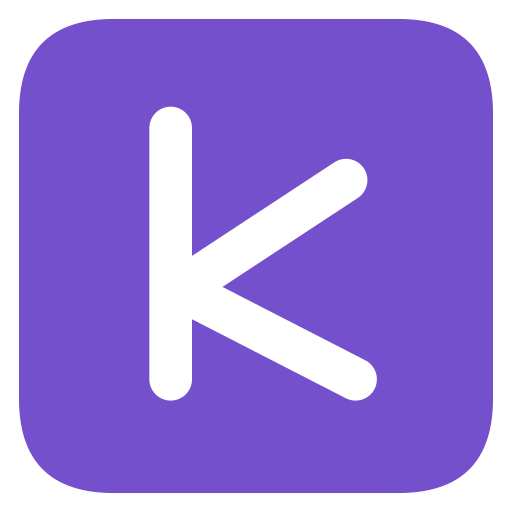
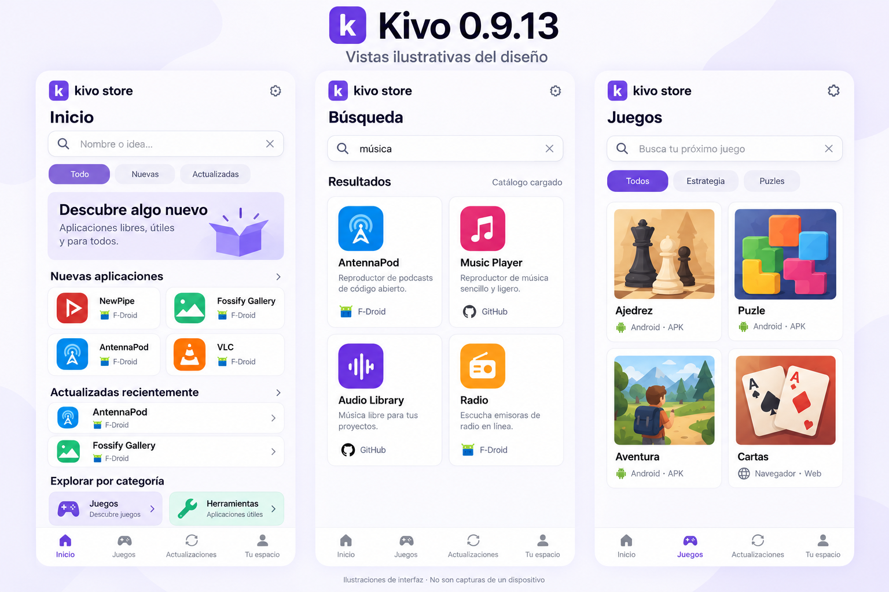

# Kivo Store



Una tienda de aplicaciones para Android que reúne F-Droid, IzzyOnDroid y proyectos de GitHub en una interfaz sencilla.

**Versión: 0.9.13 · Android 8.0 o posterior · app.kivo.store**

## Descarga

El APK firmado se publica en [Releases](https://github.com/Salvador9797/kivo-store/releases). Las instalaciones y actualizaciones requieren la confirmación de Android.

## Cambios en 0.9.8

Al abrir una ficha de GitHub, Kivo lee automáticamente el paquete y el código de versión del manifiesto real del APK mediante solicitudes HTTPS Range limitadas. Después consulta ese paquete directamente a Android. La acción principal ofrece Abrir, Actualizar o Descargar según el resultado, sin depender del historial de descargas y sin vinculación manual. Mientras comprueba, o si falla la comprobación, no asume que la app está ausente.

La lectura parcial tiene límites de tamaño y formato y requiere un servidor que soporte rangos (o un APK pequeño). Si no puede completarse, la interfaz muestra el error y permite reintentar. La inspección de metadatos no equivale a verificar la firma del APK completo: las comprobaciones de integridad, paquete y certificado siguen realizándose antes de instalar.

Las consultas públicas de GitHub pueden recuperarse sin autenticación cuando una sesión devuelve HTTP 401. El perfil y la publicación de opiniones siguen requiriendo autenticación válida; no se reintentan escrituras como anónimo.

## Qué ofrece

- Descubrimiento por necesidades, colecciones, nuevos proyectos, populares y lanzamientos.
- Catálogos de F-Droid y GitHub, búsqueda y estrellas de GitHub.
- Detección local de apps instaladas y comprobación de actualizaciones compatibles.
- Comprobación de integridad, paquete y firma antes de instalar APK compatibles.
- Descripciones traducidas al español con consentimiento previo mediante MyMemory.
- Comentarios públicos y calificaciones de 1 a 5 mediante la cuenta de GitHub y el repositorio de comunidad.

## Vistas previas del nuevo estilo

Inicio, búsqueda por funciones y catálogo de juegos de Kivo 0.9.13.



Estas imágenes son ilustraciones del diseño, no capturas de un dispositivo. Los nombres, iconos y resultados son ejemplos; la disponibilidad depende del catálogo cargado.

[Descargar Kivo 0.9.13](https://github.com/Salvador9797/kivo-store/releases/tag/v0.9.13)

## Compilar

Requisitos: JDK 17, Android SDK 35 y acceso a Google Maven/Maven Central. Gradle 8.9 y Android Gradle Plugin 8.7.3 están fijados en el proyecto.

```sh
chmod +x gradlew
./gradlew :app:assembleRelease
```

La compilación Gradle genera un APK sin firmar. La clave privada de desarrollo no forma parte de este repositorio. El APK publicado fue compilado mediante `tools/build.py` con las herramientas del SDK y ECJ; el script documenta ese procedimiento. No se afirma que el resultado de ambos procedimientos sea idéntico bit a bit.

Pruebas de interfaz:

```sh
npm install
npm test
```

Consulta `VALIDATION.md` para los límites de la validación. No se ha completado una prueba integral en un teléfono físico de esta versión desde el entorno de desarrollo.

## Privacidad y servicios

El inventario de apps se consulta localmente. GitHub se usa para catálogo, descargas y comunidad. El inicio de sesión solicita `public_repo`; los comentarios son públicos. El token se protege mediante Android Keystore. La traducción opcional envía la descripción a MyMemory después del consentimiento y está sujeta a sus límites. No se incluyen claves privadas ni secretos OAuth en el código.

## F-Droid

La inclusión en el catálogo oficial requiere revisión independiente. Este repositorio no implica aceptación ni disponibilidad en F-Droid. Se preparan metadatos upstream y una solicitud que documenta las verificaciones pendientes.

## Licencias y créditos

Copyright (C) 2026 Salvador9797 y colaboradores de Kivo Store.

El código original de Kivo y su icono se distribuyen bajo **GPL-3.0-or-later**, sin garantía. Consulta `LICENSE`. Los catálogos, iconos de otras apps y Lucide conservan sus licencias y titulares; consulta `THIRD_PARTY_NOTICES.md`. Los nombres y marcas de terceros se usan para identificar sus aplicaciones y no implican afiliación.

## Comunidad

[Reportar un error](https://github.com/Salvador9797/kivo-store/issues) · [Comentarios de aplicaciones](https://github.com/Salvador9797/kivo-comunidad)
